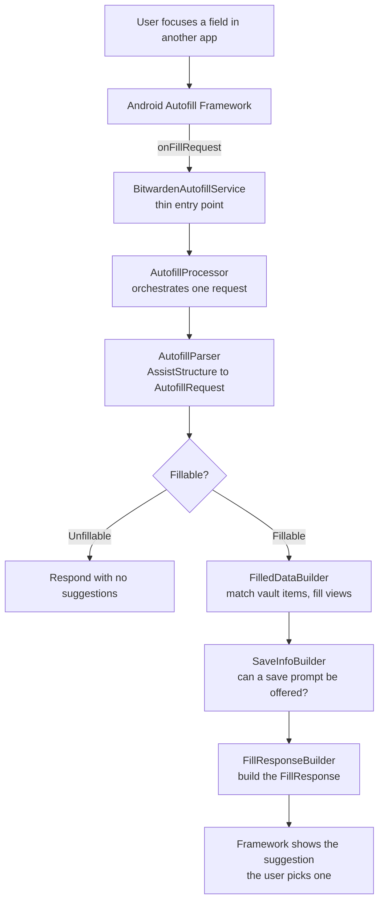
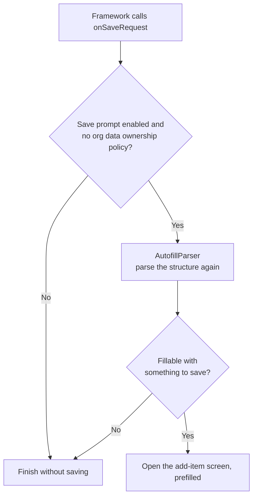

# Autofill

A short overview of how autofill works in the Password Manager app: enough to find your way around and start debugging, without a deep dive into every heuristic. Paths below are relative to `app/src/main/kotlin/com/x8bit/bitwarden/data/autofill/` unless noted.

## Scope

There are two ways the app fills credentials into other apps and websites:

1. **The Android Autofill Framework** (this document's focus). The system asks our `AutofillService` for suggestions when the user focuses a field.
2. **The accessibility fallback.** For browsers and apps that do not work with the framework, the `accessibility/` package reads the screen through an `AccessibilityService`. It has its own parser and processor.

Passkeys and Credential Manager are separate features and are not covered here.

## How a fill request flows

Saving follows a shorter path:

## Main components

| Component | Role |
|-----------|------|
| [`BitwardenAutofillService`](../app/src/main/kotlin/com/x8bit/bitwarden/data/autofill/BitwardenAutofillService.kt) | The `AutofillService` the system binds to. Kept light on purpose; it only forwards to the processor. |
| [`AutofillProcessor`](../app/src/main/kotlin/com/x8bit/bitwarden/data/autofill/processor/AutofillProcessorImpl.kt) | Runs a fill or save request end to end and calls back to the framework. |
| [`AutofillParser`](../app/src/main/kotlin/com/x8bit/bitwarden/data/autofill/parser/AutofillParserImpl.kt) | Walks the `AssistStructure`, classifies fields, picks the focused partition and the URI. The most intricate part. |
| [`FilledDataBuilder`](../app/src/main/kotlin/com/x8bit/bitwarden/data/autofill/builder/FilledDataBuilderImpl.kt) | Turns a `Fillable` request plus matching vault items into data ready for the response. |
| [`AutofillCipherProvider`](../app/src/main/kotlin/com/x8bit/bitwarden/data/autofill/provider/AutofillCipherProviderImpl.kt) | Supplies the vault items (logins matched by URI, cards, identities) and reports whether the vault is locked. |
| [`SaveInfoBuilder`](../app/src/main/kotlin/com/x8bit/bitwarden/data/autofill/builder/SaveInfoBuilderImpl.kt) | Builds the framework `SaveInfo`, or returns null when a save should not be offered. |
| [`FillResponseBuilder`](../app/src/main/kotlin/com/x8bit/bitwarden/data/autofill/builder/FillResponseBuilderImpl.kt) | Builds the final `FillResponse`. |
| [`FillAssistManager`](../app/src/main/kotlin/com/x8bit/bitwarden/data/autofill/manager/FillAssistManagerImpl.kt) | Fetches and caches server-provided targeting rules (see below). |

## Key models

- **`AutofillRequest`**: either `Fillable` (has a partition, a URI or package name, and inline presentation data) or `Unfillable` (no suggestions).
- **`AutofillView`**: one classified field, such as `Login.Username`, `Login.Password`, `Card.Number`, `Identity.*`, or `Unused` for inputs we do not fill.
- **`AutofillPartition`**: the group of views being filled together: `Login`, `Card` or `Identity`. The parser picks the partition of the first focused view.
- **`FilledData`**: the result of matching and filling, ready to turn into a response.

Identity autofill is behind the `IdentityAutofill` feature flag. With the flag off, a focused Identity field makes the request `Unfillable`.

## How a page or app is matched to vault items

The parser produces one URI per request:

- For web content, it is built from the web domain the structure reports (`webDomain`), or from a browser's URL bar for the browsers listed in `AutofillParserImpl`.
- Otherwise it falls back to the app: `androidapp://<package name>`.

Logins are matched against that URI by `CipherMatchingManager`, so a missing web domain means we match against the browser app itself and find nothing for the site. Card and identity items do not depend on the URI. If the vault is locked there is nothing to match, and the response reflects that instead.

## Browsers and compatibility mode

Some browsers do not report web content to the framework themselves. The service declares them in [`autofill_service_configuration.xml`](../app/src/main/res/xml/autofill_service_configuration.xml) as `compatibility-package` entries, each with a maximum version code. For those browsers, up to that version, Android builds the structure through accessibility data and sets the compatibility-mode flag on the request. Newer builds are expected to support autofill natively. Keep that list in sync with `ACCESSIBILITY_SUPPORTED_BROWSERS` in `accessibility/util/BrowserUtil.kt`, as the comment in the XML says.

Compatibility mode has limits. For example, a login's password may be masked, so a save is not offered for a login in compat mode.

## Fill assist

Fill assist is a set of server-provided rules, keyed by site, that point at specific fields with selectors. When the feature flag and the user setting are both on, and the rules for a host cover the focused field's category, those rules replace the heuristic classification for that request. If the rules match nothing, the request ends up `Unfillable` rather than falling back to the heuristics. Hosts with no rules use the heuristics as usual.

## Debugging

### Logging the heuristics (view structure)

The parser can log every node it sees. It is off by default because the output can contain user data.

1. In `parser/util/LogUtil.kt`, set `ENABLE_ASSIST_STRUCTURE_LOGS` to `true`. **Do not commit this change.**
2. Run a debug build, then reproduce the problem. Each node is logged at verbose level with the tag `BitwardenAutofill`: the website, class name, id entry, id package and text.
3. Read the output in logcat (`adb logcat -s BitwardenAutofill`). Debug builds print logs to logcat. Release and beta builds only write logs to a file while Flight Recorder is on.

Treat these logs as private. The `text` field and other attributes can include what the user typed, so do not share them.

To see more per node, extend `logViewNode` locally with attributes such as `autofillHints`, `hint`, `inputType`, `webDomain` and `htmlInfo`. That is a temporary local change too.

### Other tools

- **Flight Recorder.** Records all log priorities to a file in the app's private storage, shareable from Recorded Logs.
- **`adb shell dumpsys autofill`.** Shows the current autofill service, the compatibility packages the system loaded, and recent requests. A request's system **session id** appears here and as the `@<number>` suffix on each node's `autofillId`. It is not the same number as the `-- <id>` request id in the app's own log lines.
- **Compat state.** The `Autofill Compat State` section of that dump shows which browsers the system treats as compat-mode and which URL-bar resource id it reads for each.

## Known limitations

### Firefox 160 (Android 17)

Observed on Firefox 160.0.1; this may change with newer releases.

- Android only treats Firefox as a compat-mode browser up to the version code in `autofill_service_configuration.xml`. A newer Firefox is outside that range. After widening the range locally, Firefox had to be force-stopped before the system picked up the change. This suggests Android reads the compat options when the app process starts, but that has not been confirmed.
- With Firefox running in the full browser layout, the web-content node reports a blank `webDomain` and Firefox's toolbar does not expose a `url_bar` node. No web address reaches the app, so the URI falls back to `androidapp://org.mozilla.firefox` and logins for the site are not matched.
- There is no fix on our side today. Widening the compat range alone does not solve it. A fix probably needs Firefox to supply the address.

## Where to go next

Read, in order: `BitwardenAutofillService`, `AutofillProcessorImpl`, then `AutofillParserImpl` (start at `parseInternal`). The parser tests (`AutofillParserTests`) show the input shapes the heuristics are expected to handle. For the accessibility path, start at `accessibility/BitwardenAccessibilityService.kt`.
